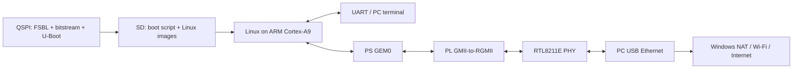

# Zynq-7020 Embedded Linux Bring-up

Buildroot Linux on a Zynq-7020 board, with a UART shell and Internet access over Ethernet. The board connects directly to a PC's USB Ethernet adapter; Windows NAT shares the PC's Wi-Fi connection. No router is used between the board and PC.

The work started with JTAG-loaded Linux, then moved to standalone boot: QSPI Flash holds the FSBL, FPGA bitstream and existing U-Boot, while SD holds the kernel, Device Tree and initramfs. One physical power-cycle test reached the root shell and network without a JTAG download or manual U-Boot commands.

## System Flow



GEM0 is the Zynq PS hard Ethernet MAC. The PL bridges its EMIO GMII interface to the board's RGMII PHY; it is not a custom Ethernet MAC. Linux uses MACB/GEM, PHYLIB, the Realtek PHY driver and the Xilinx GMII-to-RGMII driver.

## Bring-up Work

- Generated the PS/PL design and pin constraints in Vivado Tcl, then used XSCT to check DDR access and load Linux through JTAG.
- Built the kernel, Device Tree and initramfs with Buildroot, including Bash and ethtool for board-side debugging.
- Fixed an inherited UART pinctrl conflict: the base Device Tree selected MIO48/49, but this board connects UART1 through EMIO.
- Traced a link-up-but-no-transfer failure to the GEM clock gate. A small MACB patch keeps clock gating intact while leaving the PL-generated GMII clock rate alone.
- Kept the existing U-Boot binary unchanged. An SD boot script bounds initramfs relocation to Linux's memory range, and an FSBL handoff hook clears stale UART RX before U-Boot's countdown.

The sequence of failed experiments, register observations and fixes is in [UART and Ethernet Debugging](docs/UART_ETHERNET_DEBUG_STORY.md) and [Flash and SD Boot](docs/BOOT_MEDIA.md).

## What Was Verified

| Check | Observed result |
| --- | --- |
| Standalone boot | One physical cold boot and automatic warm reboot reached Linux |
| UART commands | Root login, Bash 5.2.37 and kernel logs |
| Ethernet transfers | Two 100-round runs at a 1 Gbps link; 1 MiB each direction per round, matching SHA-256 hashes |
| After cold boot | Gateway ping 3/3, public IPv4 ping 5/5 and DNS resolution; RX/TX errors both zero |
| Media programming | QSPI and SD image readbacks matched the written images |

These are bounded tests, not a claim of gigabit application throughput or long-term reliability. The [validation record](docs/VALIDATION.md) separates PASS, FAIL and NOT TESTED, with [cold-boot output](docs/evidence/cold-boot.txt) and [post-boot network output](docs/evidence/network.txt).

## Build And Run

The tested tools are Vivado/Vitis 2025.2 on Windows, WSL2 Ubuntu 22.04, Buildroot 2026.05 and Xilinx Linux 6.18.10. Build Linux from a checkout on WSL's Linux filesystem, not `/mnt/c`.

```bash
bash buildroot-external/scripts/setup_ubuntu.sh
bash buildroot-external/scripts/bootstrap_buildroot.sh
```

The outputs include `zImage`, `zynq7020-bringup.dtb`, `rootfs.cpio.gz` and `sdcard.img`. See [Build and Deploy](docs/BUILD_AND_DEPLOY.md) for Vivado, WSL image copying and XSCT commands. [JTAG Debugging](docs/JTAG_DEBUGGING.md) covers the recovery path, which bypasses the normal boot chain.

For UART, use 115200 baud, 8N1, no flow control; log in as `root`, then enter `bash`. The tested board address is `192.168.7.2/24`, with the PC at `192.168.7.1`. Internet access requires NAT on the PC; the board scripts do not configure the host automatically.

## Repository

- `hardware/`: Vivado design, constraints, MDIO buffer, FSBL hook and JTAG/boot packaging Tcl.
- `buildroot-external/`: Defconfig, Device Tree, kernel patch, rootfs overlay and image generation.
- `scripts/`: UART/network checks, image copying and explicit media writers.
- `docs/`: Build instructions, wiring notes, debugging and recorded validation.

Generated builds and flash backups stay local. QSPI packaging requires the preserved `u-boot.bin`, which is not distributed here; its hash is recorded in `hardware/boot/`. JTAG bring-up does not require that binary. Builds never program Flash or SD automatically.

## Limits

The root filesystem runs from initramfs, so runtime changes are not persistent. The image has no SSH server and uses a lab MAC address and root login without a password; it is for an isolated test link, not direct deployment. U-Boot retains its original ZC702 defaults and network warnings; Linux networking is the validated path. PHY strap/reset wiring discrepancies, repeated cold boots and 24-hour operation remain open in the validation record.

`main` contains this board bring-up project. The original FFT/DMA project is preserved on [`archive/fft-dma`](https://github.com/Linciyou/zynq7020-embedded-linux-bringup/tree/archive/fft-dma).
